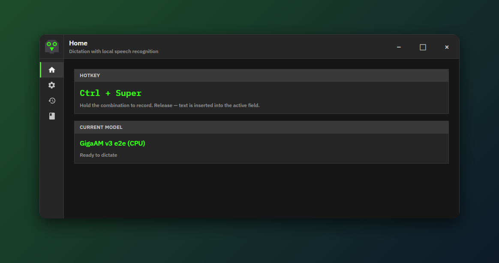
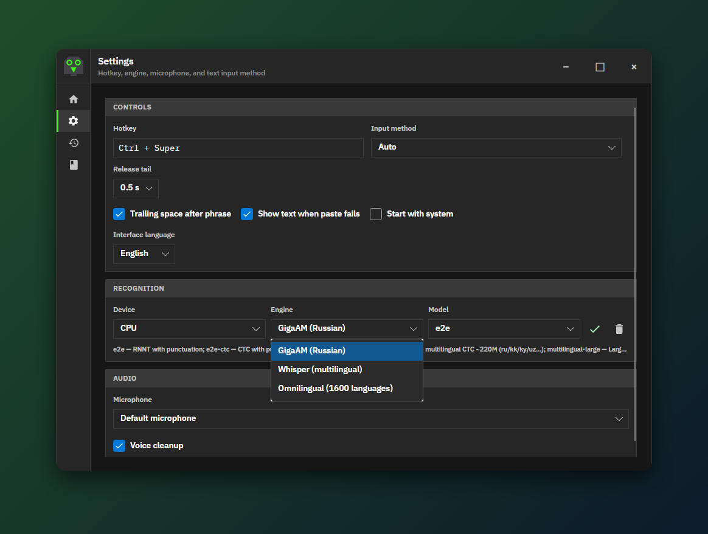
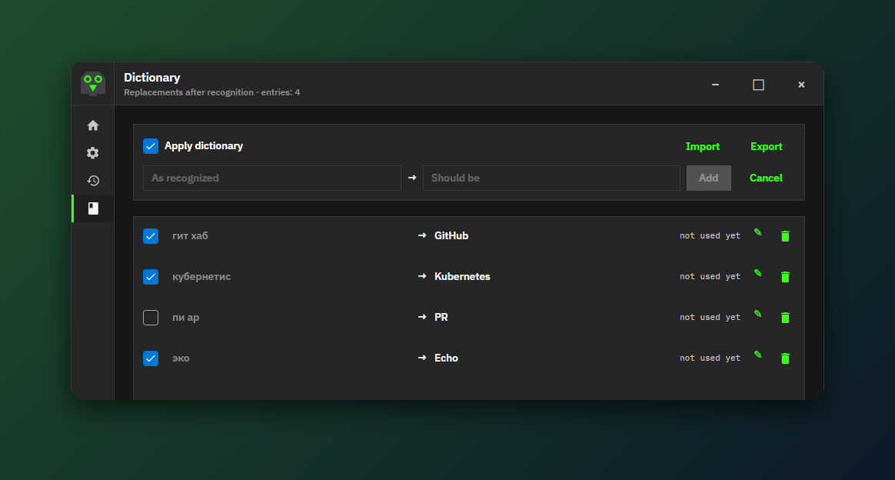
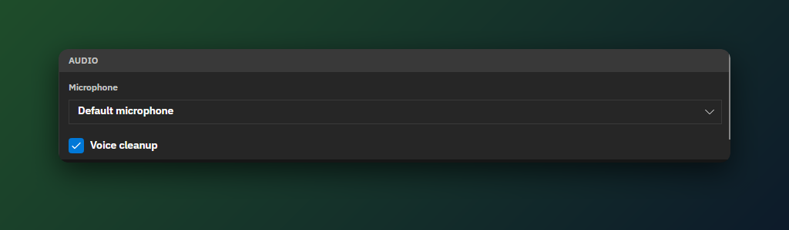

# Echo

**Local voice dictation for your desktop.** Hold a hotkey, speak, and Echo turns your speech into text — right where your cursor is.

Fully offline: audio is recognized on your machine and pasted into the active window. No cloud, no account, no subscription. [MIT License](LICENSE).



## Features

- **Works in any app** — global push-to-talk hotkey (default `Ctrl+Win`, configurable, e.g. `Win+Alt`); text is pasted at the cursor.
- **Several offline engines** — GigaAM (Russian), Whisper (multilingual), Omnilingual (1600 languages), Parakeet.
- **NPU acceleration on Snapdragon** (Windows on ARM) — Parakeet and Whisper Turbo run on the Qualcomm NPU. [Details](docs/npu-qnn-win-arm64.md)
- **GPU acceleration** via DirectML on Windows for GigaAM and Omnilingual. [Details](docs/gpu-directml.md)
- **Voice cleanup** — built-in noise suppression (FastEnhancer) before recognition.
- **Dictionary** — "as recognized → should be" replacements, plus **learning from your corrections**: edit the pasted text and Echo suggests a dictionary entry. [Details](docs/dictionary.md)
- **History**, release-tail trimming, in-app updates.

## Download

Get the latest build from **[Releases](https://github.com/bkamuz/echo/releases/latest)**.

| Platform | File | Run |
|---|---|---|
| Windows x64 | `Echo-*-win-x64-portable.zip` | Unzip, run `Echo.App.exe` |
| Windows ARM64 (Snapdragon) | `Echo-*-win-arm64-portable.zip` | Unzip, run `Echo.App.exe` (NPU runtime is downloaded on first use) |
| Linux x64 | `.deb` / `.AppImage` / `.tar.gz` | `sudo apt install ./Echo-*.deb` or `chmod +x Echo-*.AppImage && ./Echo-*.AppImage` |
| macOS (Apple Silicon) | `Echo-*-osx-arm64-portable.tar.gz` | In development — dictation not functional yet |

Linux: tested on Ubuntu GNOME (Wayland); X11 works too. Some setups need extra tools for text insertion — Echo will tell you which.

## Quick start

1. Run Echo, open **Settings**, pick hotkey, microphone, device and engine. The model downloads once.
2. Click into any text field, **hold the hotkey**, speak, **release** — the text is pasted.
3. Echo lives in the system tray; right-click it for settings and history.

## Engines and devices



| Engine | Languages | CPU | GPU (DirectML) | NPU (Snapdragon) |
|---|---|:-:|:-:|:-:|
| GigaAM v3 | Russian (default) | ✓ | ✓ | |
| Whisper (tiny … large-v3-turbo) | Multilingual | ✓ | | |
| Whisper Turbo (NPU) | Multilingual | | | ✓ |
| Omnilingual ASR | 1600 languages | ✓ | ✓ | |
| Parakeet TDT | English + European | ✓ | | ✓ |

Parakeet and Whisper Turbo NPU are available on Windows ARM64 only.

## Dictionary and voice cleanup



With **Learn from my corrections** on, Echo watches the field for a while after pasting (45 s by default). Fixes you make become disabled suggestions — enable the ones you want. Apps can be excluded. Works on Windows (UI Automation), Linux (AT-SPI; needs `python3-gi` and `gir1.2-atspi-2.0`, not available on GNOME Wayland) and macOS (allow Echo under Privacy & Security → Accessibility).

**Voice cleanup** (Settings → Audio) removes background noise before recognition:



## Troubleshooting

- **Hotkey or paste does nothing in some windows (Windows)** — the target app runs as administrator. Windows blocks non-elevated apps from it (UIPI). Run Echo as administrator too, or don't run the target elevated.
- **Correction learning doesn't see edits in Cursor / VS Code editor** — add `"editor.accessibilitySupport": "on"` to the editor settings (the chat box works without it).
- **Logs** (Windows): `%APPDATA%\Echo\echo.log`; update problems: `%APPDATA%\Echo\echo-update.log`. Attach them to [issues](https://github.com/bkamuz/echo/issues).
- **Data folder** (models, settings, history, `dictionary.json`): Windows `%APPDATA%\Echo`, Linux `~/.config/echo`, macOS `~/Library/Application Support/Echo`. Not removed on uninstall.

## Build from source

Requires [.NET 10 SDK](https://dotnet.microsoft.com/download).

```bash
dotnet build Echo.slnx
dotnet run --project src/Echo.App
```

Bug reports and PRs are welcome — include OS, Echo version and logs.
